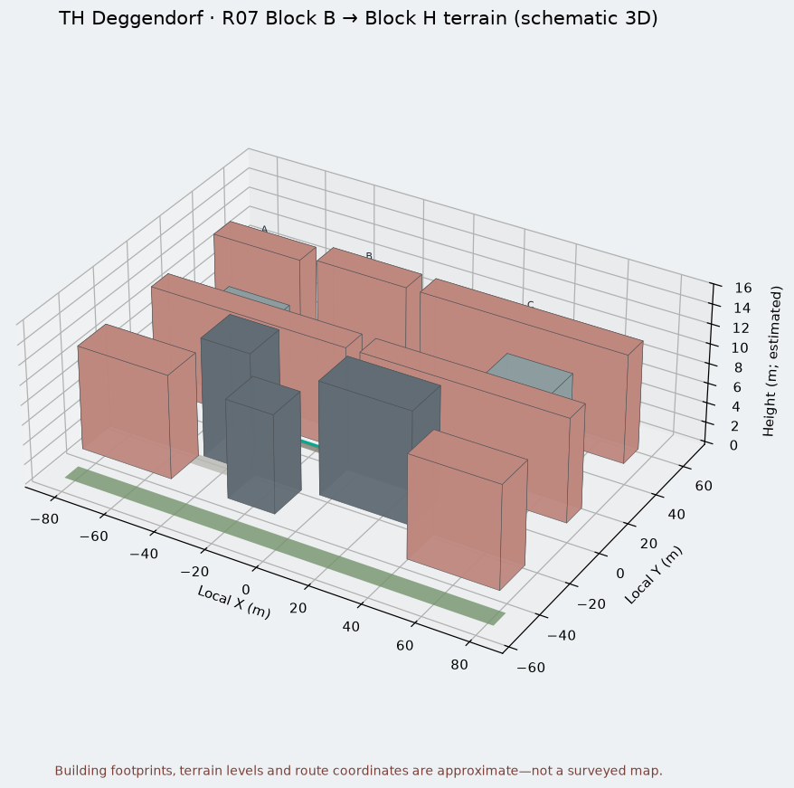
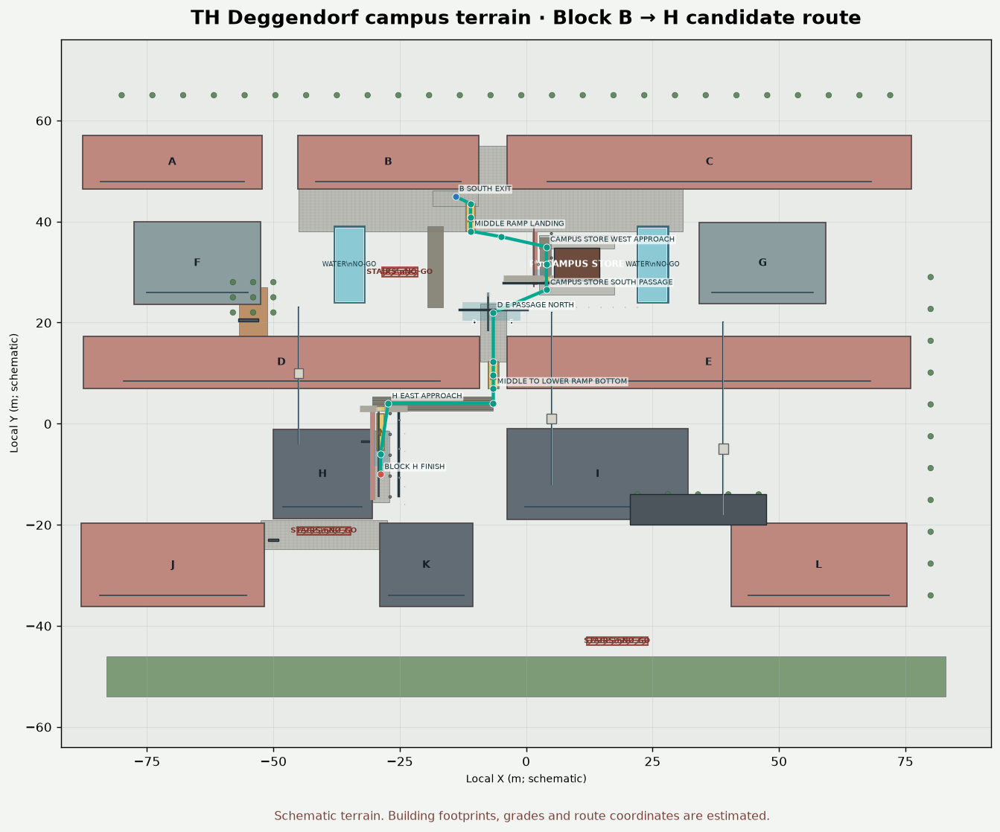
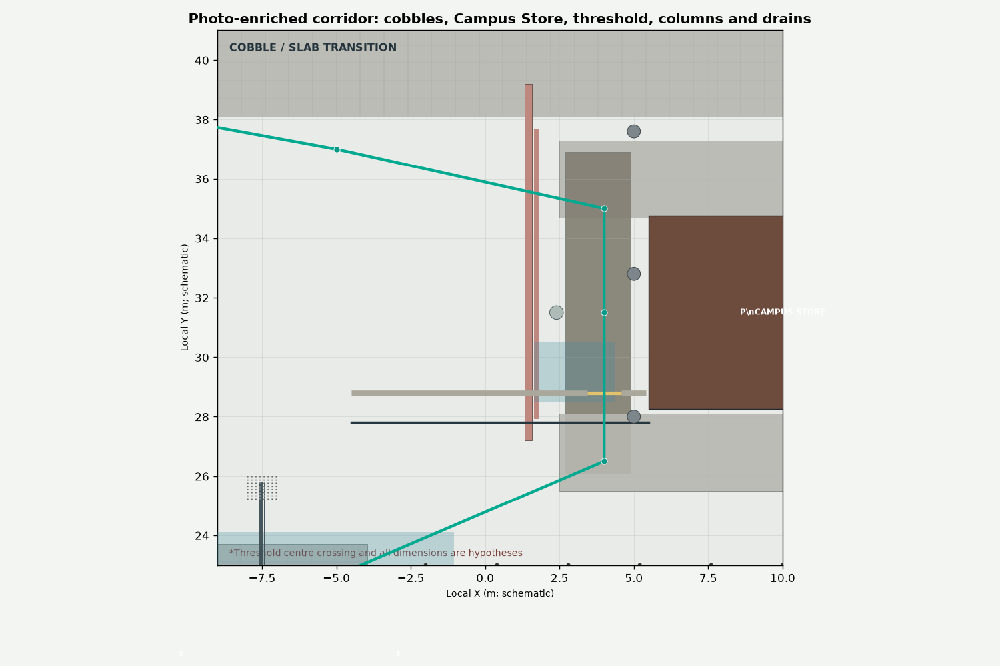
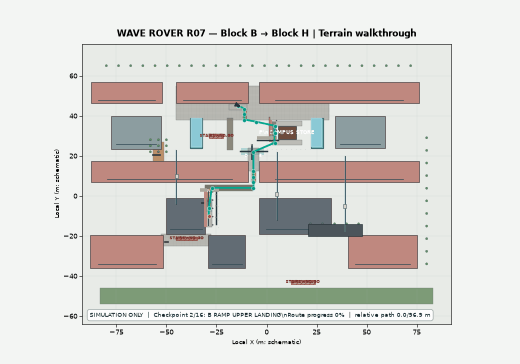

# Case-Study-Cooperative-and-Autonomous-Systems

This branch adds a simulation workspace for CAS Box B3 / WAVE ROVER R07 alongside the existing ESP32 sensor-box firmware.

## Start here
- [Simulation documentation](simulation/README.md)
- [TH Deggendorf Block B → Block H terrain (schematic JSON)](simulation/terrain/dit_deggendorf_b_to_h.json)
- [Interactive 2D simulator](simulation/tools/r07_campus_sim.py)
- [ROS 2 / Gazebo Classic R07 robot model](simulation/ros2_ws/src/r07_description/urdf/r07_rover.urdf.xacro)
- [Campus world for Gazebo](simulation/ros2_ws/src/r07_simulation/worlds/dit_b_to_h.world)

## Important accuracy notes
- The known rover footprint represented in the simulation is 0.30 m long × 0.20 m wide.
- CAS Box dimensions, wheel track/radius, sensor bearings/mounting points and metric campus geometry are editable estimates where not measured.
- The campus diagram is not surveyed. The B → H route is a candidate path-planner test; confirm entrances, walkways, terrain and obstacles before using a real rover.
- The main ESP32 firmware and rover firmware are not changed by the simulation additions.

## Simulation screenshots and video

The simulation terrain is documented visually below. These images and the walkthrough are generated from the editable detailed campus terrain model in `simulation/terrain/dit_deggendorf_b_to_h_detailed.json`.

### 3D terrain overview

### Top-down route and terrain layout

### Campus Store and corridor detail

### Route walkthrough

[**Open or download the MP4 simulation walkthrough**](simulation/media/route_walkthrough.mp4)

> **Accuracy note:** this is a simulation of a researched schematic, not a surveyed digital twin. Building footprints, ramps, surface friction and the route are estimated. The raised threshold's centre crossing is a hypothesis. This media validates the visualization workflow, not physical rover safety or navigation performance.

