# cas_box_mission — autonomous route B → Open Sea → Block I (kit 04, firmware v10)

This is the ESP32 "box" firmware that drives the Waveshare WAVE ROVER from the B building to the KARL glass entrance of Block I. It uses a LiDAR, an IMU and ultrasonic sensors. No GPS waypoints and no camera are used. The rover firmware itself is never changed: the box only sends `T:1` wheel commands over HTTP and reads `T:130` / `T:139`.

> **Status (2026-11-09):** v10 compiles (96 % flash). It has been replayed on all recorded runs and checked in simulation. **It has not been driven yet.** Every number below comes from replays of real logs or from the simulator in `tools/`.

---

## 1. The route

| Leg | Where | What the box uses | End of the leg |
|---|---|---|---|
| 1 | along the B facade (wall on the left, pillars on the right) | wall following at 1.0 m (Kethan's heading hold) | right turn at the pillar with the **black THD sign** behind it |
| 2 | **Open Sea** (~36–49 m of open ground, tactile strip) | B wall behind, left landmark line (store front), building front, end wall ahead | **wide** end wall 1.5 m ahead → right turn |
| 3 | arcade wall on the left | wall following at 0.6 m | wall ends → T3 left turn |
| 4 | wall → interlock walkway → railing corridor | wall, left edge, right railing, facade | **KARL glass entrance + 1.5 m → ARRIVED** |

```mermaid
stateDiagram-v2
    [*] --> IDLE
    IDLE --> L1_FOLLOW: Start mission
    L1_FOLLOW --> T1_TURN: sign structure locked + pillar edge + 0.40 m
    L1_FOLLOW --> T1_ASK: no sign found (asks, never guesses)
    T1_ASK --> T1_TURN: "Turn RIGHT here"
    T1_TURN --> T1_SETTLE --> L2_GO
    L2_GO --> HOLD: something < 0.6 m ahead
    HOLD --> L2_GO: way free for 2 s
    L2_GO --> L3_FOLLOW: wide end wall (counter reaches 6)
    L3_FOLLOW --> L4_FOLLOW: wall ends, T3 left turn
    L4_FOLLOW --> DONE: KARL entrance + 1.5 m / any hold after the corridor
    note right of HOLD: also from L1/L3/L4.\nSTOP and tilt -> PAUSED (needs Resume)
```

---

## 2. Hardware and files

| Part | Use | Datasheet facts used |
|---|---|---|
| LDROBOT LD20 LiDAR (90 bins × 4°, mounted 83° offset) | walls, landmarks, obstacles | LD19 family: 0.02–12 m, 4,500 samples/s, 30 klux sunlight (no LD20 sheet found) |
| BNO055 IMU | heading (gyro), pitch / roll (tilt, ramp) | NDOF drift is mostly magnetic |
| 5 × HC-SR04 (front one angled 45° down) | close obstacles, ghost check | 2–400 cm, ~15° cone, ≥ 60 ms per ping |
| WAVE ROVER (ESP32 + motor driver) | wheels | JSON `T:1` at 10 Hz, 0.5 s deadman |

| File | What it does |
|---|---|
| `RouteMission.cpp/.h` | the whole mission state machine (all rules below) |
| `DriveStraight.h` | heading hold, PD + trim, 12° failsafe (Kethan) |
| `GentleDrive.h` | every speed change is a ramp (gearbox protection) |
| `WallFit.h`, `LineRef.h` | wall fit and RANSAC line fits (`rowFit`, `sectorFit`) |
| `LidarScan.h`, `Sensors.*`, `UsManager.*`, `ImuManager.*` | sensors (LiDAR minimum range 35 cm) |
| `MissionLog.*` | binary log `mis_NNN.bin`, 4 records/s with all 90 LiDAR bins |
| `MissionPage.h`, `WebHMI.*` | the phone page (section 4) |
| `tools/` | laptop tools: decoder, replays, simulators (section 6) |

---

## 3. Flashing (box only)

- **Arduino IDE:** open `cas_box_mission.ino`. Settings:
  - Board: ESP32 Dev Module
  - Upload speed: 115200
  - CPU frequency: 240 MHz
  - Flash frequency: 40 MHz
  - Flash mode: DIO
  - Flash size: 4 MB
  - Partition scheme: Default 4MB with spiffs
  - PSRAM: Disabled
  - **Erase All Flash: Disabled**
- **Browser (esptool-js, 115200):** `deliverables/v10_BOX/BOX_v10_cas_box_mission_0x0.bin` at address **0x0**, no erase.
- **CLI build:**
  ```
  arduino-cli compile --fqbn esp32:esp32:esp32:PartitionScheme=default,FlashFreq=40,FlashMode=dio cas_box_mission
  ```

---

## 4. Using the phone page

Connect the phone to the box Wi-Fi and open `http://<box-ip>/`. The page polls `/mis/status` every 0.5 s. (These screenshots are the real page, rendered with example values.)

| Ready | Leg 1 | Open Sea | Hold |
|---|---|---|---|
| 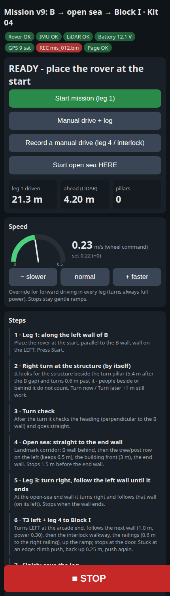 | 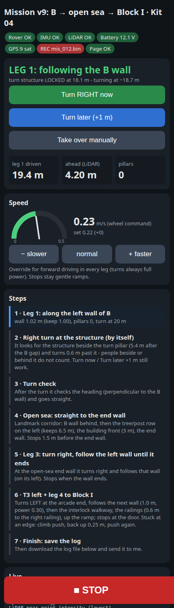 | 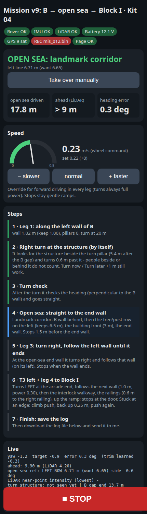 | 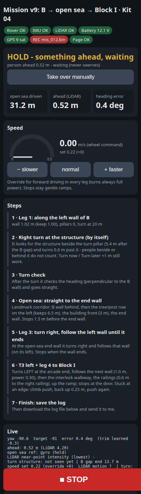 |

1. **Chips** (top): Rover, IMU, LiDAR, battery, GPS and log must be green before starting. `REC mis_NNN.bin` means the log is recording.
2. **Start mission (leg 1):** place the rover at the start of the B facade, parallel to the wall, with the wall on the LEFT, **at least ~15 m before the sign**.
3. **Status card:** the state, a message, metres driven, the distance ahead and the heading error.
4. **Speed:** the gauge shows the wheel command. `− slower / normal / + faster` change forward speed by 0.02 (−0.10 … +0.15). Turns always use full power, and stops are always ramps.
5. **Steps:** the current leg is highlighted.
6. **Live box:** the most useful lines in the field.
   - `turn structure: LOCKED at x m (turn ~y)` and `B gap end z m` (leg 1);
   - `open sea ref: LEFT ROW 6.71 m (want 6.65)`, `WALL BEHIND` or `WALL AHEAD` (leg 2);
   - `leg 4: walkway / RAILINGS` (leg 4).
7. **Question box:** if the sign is not found, the box stops and shows **Turn RIGHT here / Drive on 1 m / Manual**.
8. **STOP** (big red button) pauses everything. Only STOP and a tilt need **Resume**. A hold for people resumes by itself.
9. **Manual drive + Climb** button, **Record a manual drive**, **Start open sea HERE** for testing single legs.
10. **Log:** Start, Stop, Mark and download. Send `mis_NNN.bin` plus the phone video after every run.

> The page header still reads "Mission v9" and step 6 still mentions the ramp. Only the text is old; the logic is v10.

---

## 5. How each part works (with diagrams)

### 5.1 First turn at the THD sign (`L1_FOLLOW`)
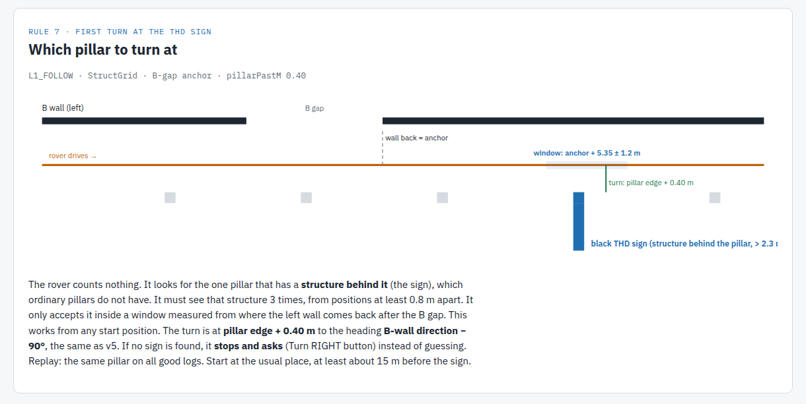
- An evidence grid (`StructGrid`, 0.1 m × 0.25 m cells) only fed by beams 2–134° looks for the **structure behind the sign pillar**: ≥ 5 cells reaching > 2.3 m to the right. Ordinary pillars have nothing behind them, and people behind the rover cannot enter the grid.
- The structure must be seen 3 times, from positions ≥ 0.8 m apart, inside a window of **B-gap end + 5.35 ± 1.2 m**. The gap end is where the left wall comes back after the gap in B, so it works from any start position.
- The turn is at **pillar edge + 0.40 m** to the heading **B-wall direction − 90°** (as in v5). No sign found → stop and ask.

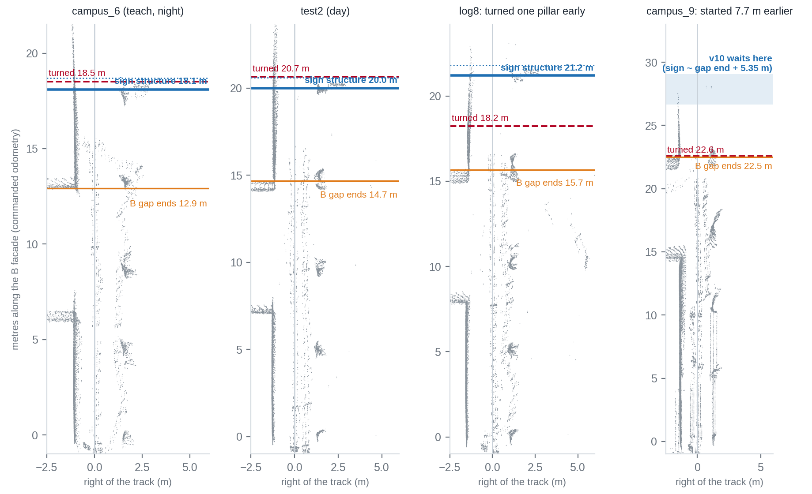

### 5.2 Open Sea: landmark corridor (`L2_GO`, unchanged since v7)
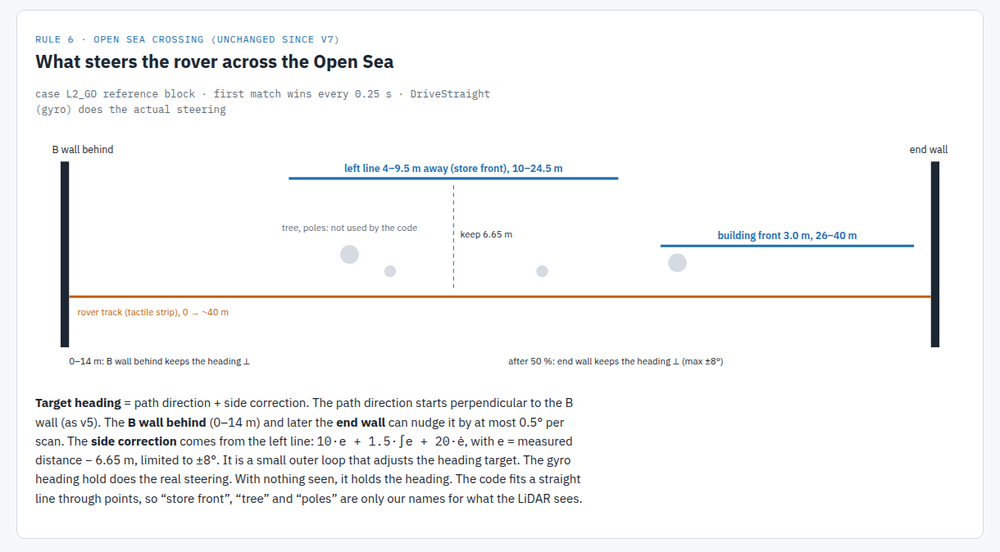
- **Heading target** = path direction + side correction. The gyro heading hold does the steering.
- **Path direction:** starts perpendicular to the B wall. The **B wall behind** (0–14 m) and the **end wall ahead** (after 50 %) can move it by at most 0.5° per scan.
- **Side correction (cross-track PID):** a RANSAC line on the left, 4–9.5 m away and parallel within ±8°, 10–24.5 m into the crossing (in practice the U-shaped store front).
  - `lat = 10·e + 1.5·∫e + 20·ė`, with `e = distance − 6.65 m`, limited to ±8°.
  - From 26 to 40 m the building front at 3.0 m takes over.
- With nothing seen, it holds the heading.

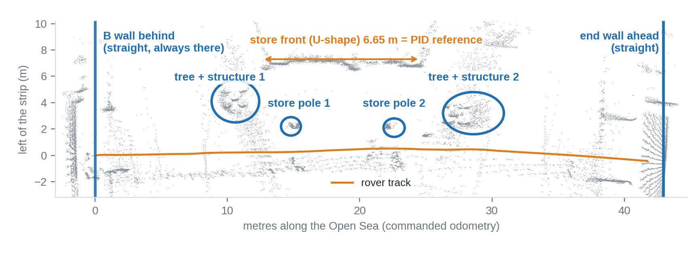

### 5.3 Open Sea end wall: nearest surface (v10)
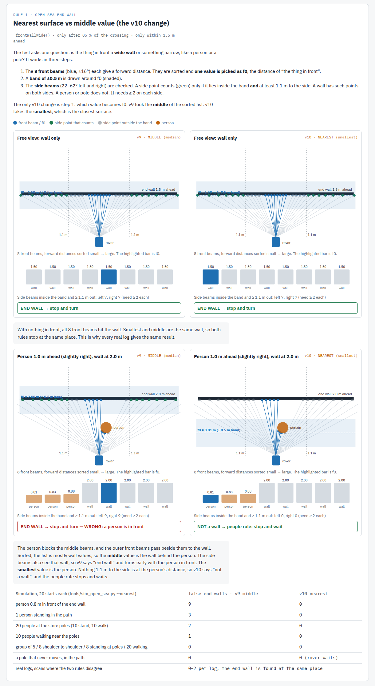
- Only after 85 % of 36 m, front ≤ 1.5 m and the rover level. The wall must be **wide**: ≥ 2 side beams on each side, ≥ 1.1 m out, within 0.5 m of **f0 = the nearest front surface**. v9 used the median, which could land on the wall behind a person.
- A leaky counter (+2 / −1 per 0.25 s, trigger 6) decides the stop.

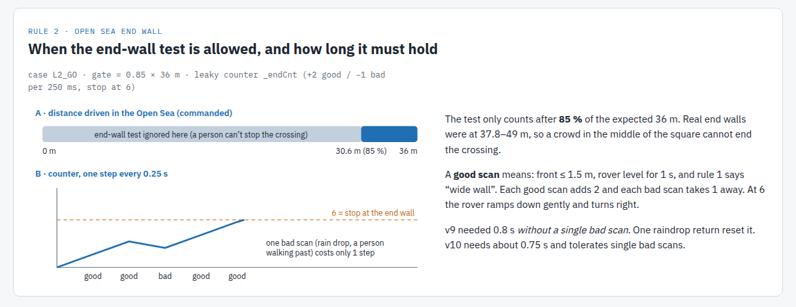

### 5.4 People, obstacles and the campus_9 fix
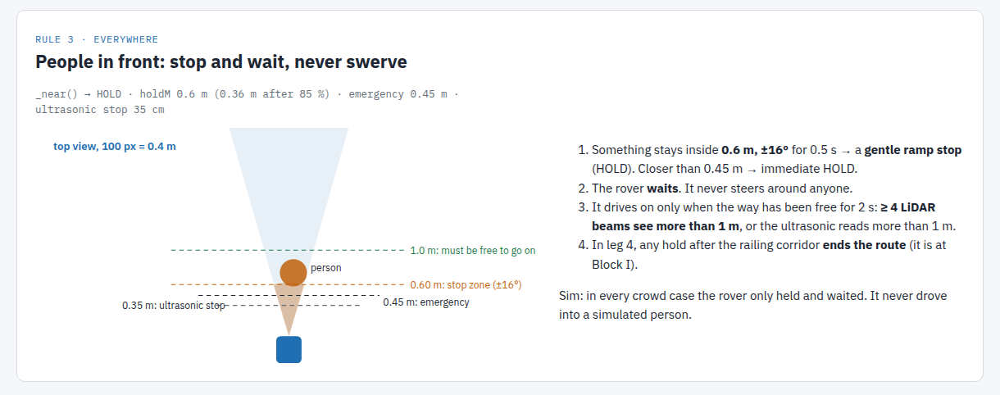
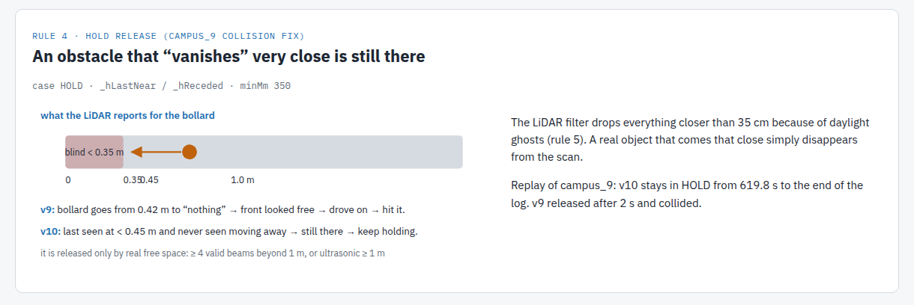

### 5.5 Daylight LiDAR ghosts
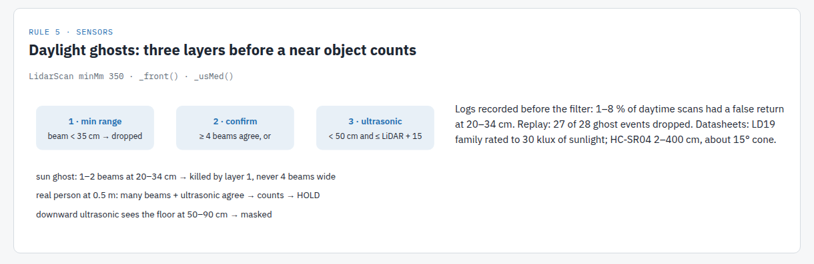
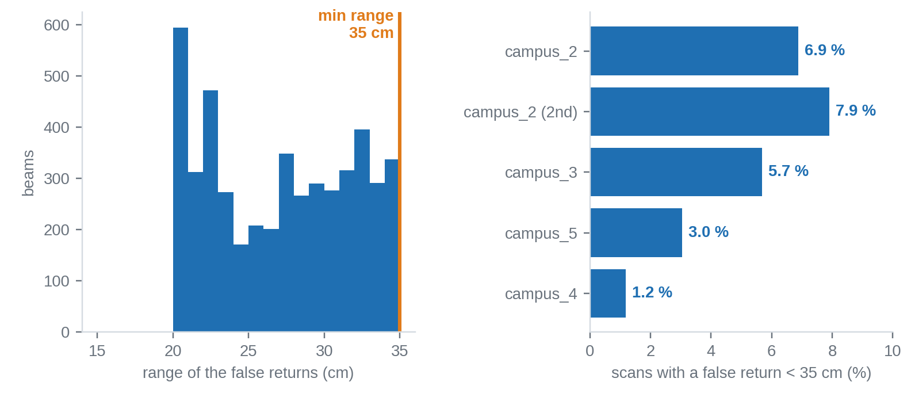

### 5.6 Leg 4 to the KARL glass entrance
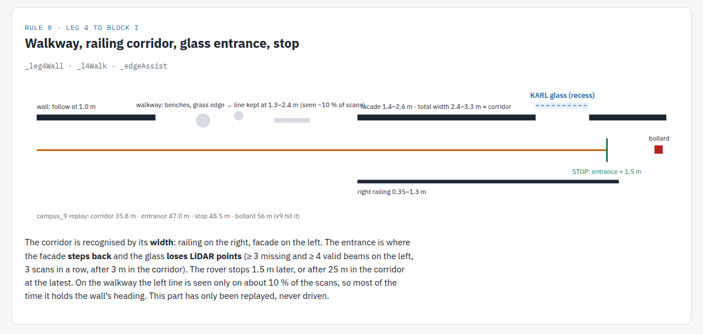
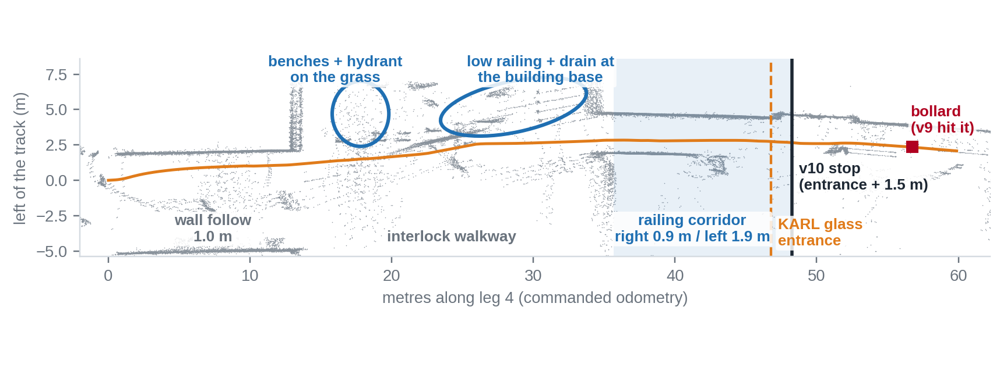
- **Wall follow:** 1.0 m at power 0.30.
- **Walkway:** keeps its first distance (1.3–2.4 m) to a left edge line when one is seen. That was only ~10 % of scans in campus_9; otherwise it holds the wall heading.
- **Railing corridor:** right railing 0.35–1.3 m, facade 1.4–2.6 m, width 2.4–3.3 m.
- **KARL entrance:** the facade steps back and the glass drops beams. The rover stops 1.5 m later.
- **Edge assist:** pushes over the cobble edge, but only if nothing is closer than 1.2 m ahead.

---

## 6. Laptop tools (`tools/`)

| Command | Purpose |
|---|---|
| `python3 decode_mission_log.py mis_001.bin` | binary log → CSV / records |
| `python3 narrate_run.py <log>` | "what the rover thought", step by step |
| `python3 replay_turn.py` / `sweep_start.py` | first turn on every log; start shifted −8…+8 m |
| `python3 replay_sea_gate.py` | Open Sea references on the real logs |
| `python3 replay_end_wall.py` | v9 vs v10 end-wall rule on every real log |
| `python3 replay_leg4_end.py` | railing corridor + KARL entrance on campus_9 / log8 |
| `python3 sim_open_sea.py --crowd / --env / --faults / --nearest` | closed-loop Open Sea simulation: crowds, weather, faults, nearest-surface rule |
| `python3 sim_people.py` | people injected into real leg-1 scans (turn) |
| `python3 landmark_benchmark.py` | landmark distances over all logs (`landmark_db.json`) |
| `fwmirror.py` | Python copy of the firmware rules used by all of the above. **Keep it in sync with `RouteMission.cpp`.** |

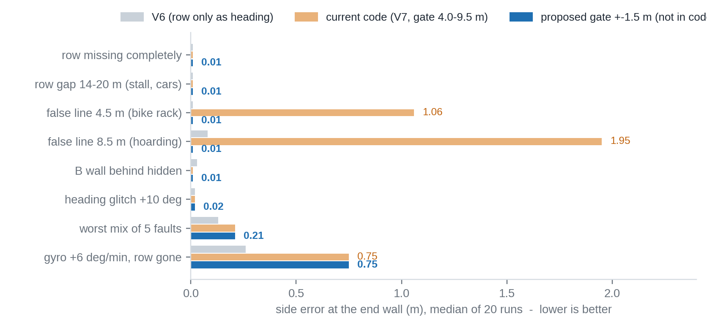

---

## 7. v9 → v10

| Area | v9 | v10 | Why (log / sim) |
|---|---|---|---|
| Turn window | 15–25 m, blind turn at `turnAt+2.5` | B-gap end + 5.35 ± 1.2 m, no blind turn (asks) | campus_9 started 7.7 m earlier and turned one pillar early |
| Turn target | own heading if the wall was not seen | last good B-wall direction − 90° | campus_9 |
| End wall | median f0, 70 % gate, 0.8 s continuous | nearest f0, 85 % gate, leaky counter | crowd sim: one person 4 → 0 false end walls (v9 wide rule) |
| Hold release | released when the front looked free | a vanished obstacle (< 0.45 m) is still there; needs ≥ 4 beams > 1 m or ultrasonic ≥ 1 m | campus_9 collision |
| Leg 4 end | corridor rule right ≤ 0.85 m, stop at 60 m | corridor by width, KARL entrance, stop + 1.5 m | campus_9: corridor 35.8 m, entrance 47.0 m |
| Open Sea references, PID, gates | — | **unchanged** | crossed autonomously in log8 and campus_9 |

## 8. Known limits
- No wheel encoders: distances are commanded odometry.
- A permanent obstacle in the path → the rover waits forever. People are never avoided by steering.
- A false straight line 4–9.5 m to the left (bike rack, hoarding) could pull the Open Sea track by 1–2 m (sim). A tighter gate was tested but not applied, because it changed the real runs.
- A −15° heading glitch late in the Open Sea, or a gyro bias of 6°/min with no landmark, is not corrected (sim).
- Leg 4 walkway centering is weak, and the KARL stop is replay only.

## 9. Credits
- **Team:** starter code, Kethan's heading hold (`DriveStraight`), the turn landmark / front wall functions and the pivot step.
- **This mission layer and tools:** Arjun.
