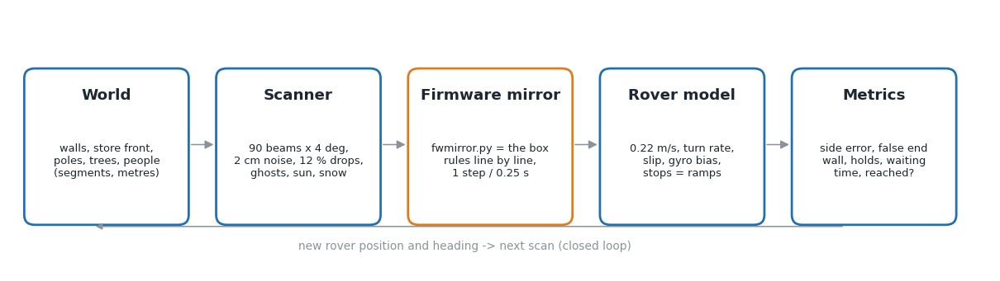
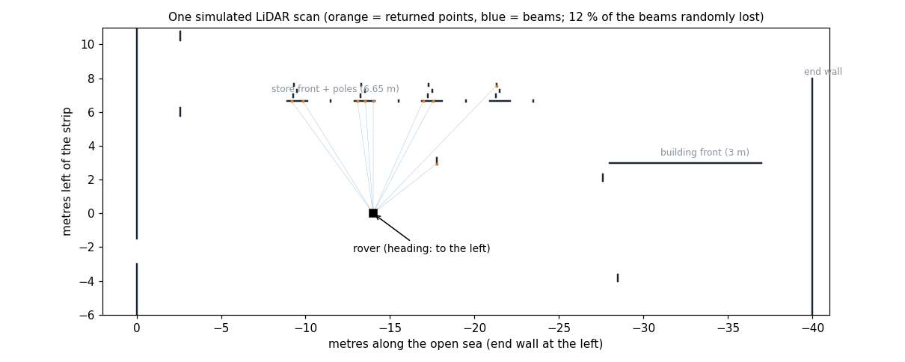
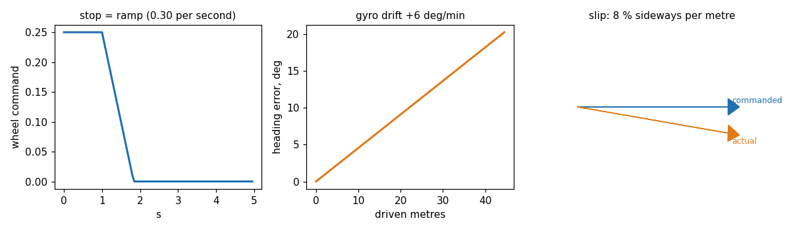

# How our Python 2D simulator works

*Rover kit 04, box firmware `cas_box_mission` v10.3. Code: `cas_box_mission/tools/`. All numbers are from runs on 9 Nov 2026 or earlier.*

## 1. What it is, in one paragraph
We cannot bring crowds, snow or a hundred different starting positions to the campus on demand, and every field test costs a day. So the box rules were copied, line by line, into Python (`fwmirror.py`), and put into a small closed-loop world: a map in metres, a simulated LiDAR that "sees" that map, and a simple rover that moves according to what the rules decide. One run = one complete crossing, thousands of runs = a table in a minute. It is **our own simulator** (about 1,500 lines of Python, no ROS, no Gazebo): the logic we want to test is ESP32 C++ without ROS, so any other simulator would still need this Python copy of the rules.



## 2. The five parts
| Part | What it does | File / function |
|---|---|---|
| **World** | Segments (lines) in metres: B wall behind, the store front with its two poles and two trees, the building front at 3 m, the end wall at 40 m, people as 0.4 m squares (standing, walking, bouncing). Positions come from the real LiDAR logs (campus_2…c102_4). | `sim_open_sea.py: world(), crowd()` |
| **Scanner** | Ray casting: 90 beams, 4° apart, angle `(i·4+2)°` clockwise from the front, the same as the real `LidarScan`. Gaussian noise 2 cm, 12 % of the beams lost, values below 35 cm removed (the real filter). **Weather and sun** are added per scan: daylight ghosts (1–2 beams at 20–34 cm in 15–20 % of scans, measured in campus_6), a blind 40° slice for low sun, snow = every beam has an 8 % chance of a random near return (0.35–3 m) and a 25 % chance of nothing. | `scan(), env_noise()` |
| **Firmware mirror** | The decision code: reference order (row, building, B wall, end wall), cross-track PID `10·e + 1.5·∫e + 20·ė` (±8°), the wide / nearest-surface end-wall check with its leaky counter, the people hold rule (0.6 m, 0.5 s), the turn structure detector (`TurnV9`, `StructGrid`), the start alignment (`StartAlign`), the leg-4 ramp-opening finder (`find_gap`). One step per 0.25 s, the same as the box. | `fwmirror.py`, `sim_start_align.py`, `replay_l4_gap.py` |
| **Rover model** | Speed 0.22 m/s (leg 4: 0.30), the heading follows the target at about 12°/s (DriveStraight), the gyro drifts (bias ±3 … 6°/min), sideways slip (3–8 % of the distance, a slanted cobblestone), pivots end ±3° off, stops are ramps. | `run(), align()` |
| **Metrics** | Side error at 24 m and at the end wall, false end-wall stops (people taken for the wall), holds and waiting time, reached or not. | `batch(), crowd_table(), env_table()` |




## 3. Is it realistic? What was checked
- **Same format as the real scan.** The row appears at the same bearing and range in a real scan of c102_3 and in the simulated scan at the same place.
- **Calibrated on logs:** the row is seen in about half of the scans, as in the real runs (15–25 % in the harder "sparse row" case we also test); ghosts, dropouts and the row distance 6.5–6.8 m come from nine logs.
- **Rules identical to the box:** `tools/replay_*.py` runs the *same* mirror on the real recorded scans of 12 logs and compares with what the box did (first turn, end wall, Open Sea references, start alignment, ramp opening). Example: `replay_end_wall.py` finds the end wall within 0.2 m of where the box really turned in 7 of the 9 runs that ended at the end wall (it misses campus_3 and test2).
- **Honest limits:** it is a model, not the campus. It has no ultrasonic at the walls, no ramp or stairs (the leg-4 ramp opening has its own small geometric sim), no wheel-ground physics, a flat world. A pass in the simulator means "the rule works if the world looks like this"; the field test still decides. Falling snow, for example, makes the end wall unconfirmed in 2 of 12 runs, and a fake straight line 4–9.5 m away (bike rack) can pull the rover 1–2 m off.

## 4. The scenarios (what we ask the simulator)
| Question | Command | Result (v10) |
|---|---|---|
| Crowds: do people look like the end wall? 12 scenarios x 20 runs | `python3 sim_open_sea.py --crowd` | person 0.8 m in front of the wall: 9 → 0 of 20 false stops; no crowd case with a false stop |
| Sun and snow, 12 runs each | `--env` | clear, glare, low sun, snowy ground 12/12; falling snow 10/12; everything at once 7/12 |
| Faults: row missing, gap, B wall hidden, false lines, heading glitches, gyro bias | `--faults --v7only` | missing row / gap / hidden wall: ≤2 cm; false line: 1–2 m |
| Nearest-surface end-wall rule | `--nearest` | no false end wall in any crowd case |
| Turn at the right pillar with people around | `python3 sim_people.py` | 5,670 cases, 93.3 % on target, 0 wrong pillar |
| Start alignment after a late turn (v10.3) | `python3 sim_start_align.py` | in-band starts untouched 100/100; late starts (+0.7 … +2.2 m) end 0.06–0.2 m off the strip |
| Start alignment in snow noise, 25 % dropouts, pivot error 6°, slip 8 %, people | `--stress` | untouched 120/120 in band; 131 of 144 late starts within 0.5 m; 0 of 144 worse. (A first version using the plain nearest point failed here: 13 of 144 worse. The simulator found it before the field did.) |
| Start pose: placed anywhere in the start area, facing any direction (wall, left, right, front) | `python3 sim_start_pose.py` | 260 of 300 within 8° / 0.5 m, no contact; heading median 2.3°; under stress 231 of 300. Fails mostly with a person standing next to the pillar. |
| Ramp opening on leg 4 | `python3 sim_l4_gap.py` | 180 approaches: 0 hits on the stairs |

## 5. How to run it
```
cd cas_box_mission/tools
python3 sim_open_sea.py --crowd       # crowd table (about 1-2 min)
python3 sim_start_align.py --quick    # start alignment, short
python3 replay_turn.py                # real logs through the turn rule
python3 make_sim_doc_figs.py          # redraw the figures of this document
```
Every tool prints a table; nothing writes to the rover or the box.

## 6. Why not LG SVL, CARLA, RViz, Gazebo or MATLAB?
| Tool | Why it is not the core of this work |
|---|---|
| LG SVL | discontinued in 2022 |
| CARLA | built for cars, roads and traffic; no campus walkways |
| RViz | a viewer, not a simulator; we use it only to *show* a log (`tools/rviz_replay.py`) |
| Gazebo / MATLAB | possible, but need a model of the box rules too; our rules are ESP32 C++, so the Python copy would still be needed. Days of work for a nicer picture, not for better proof. |
