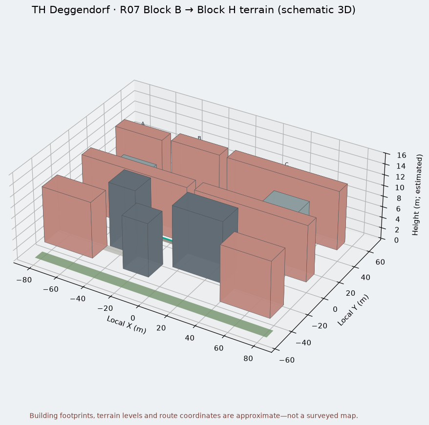
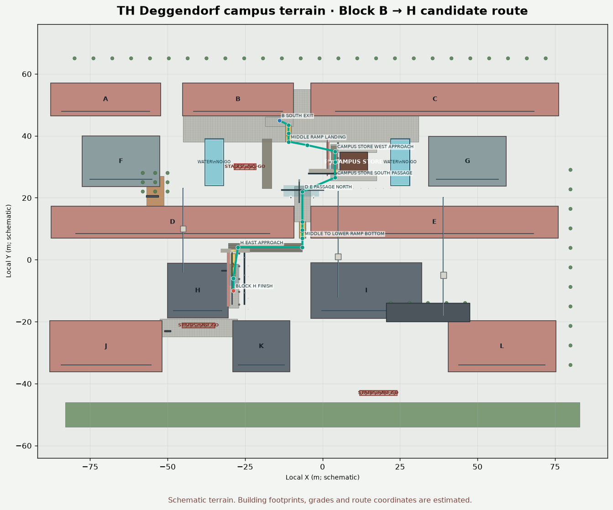
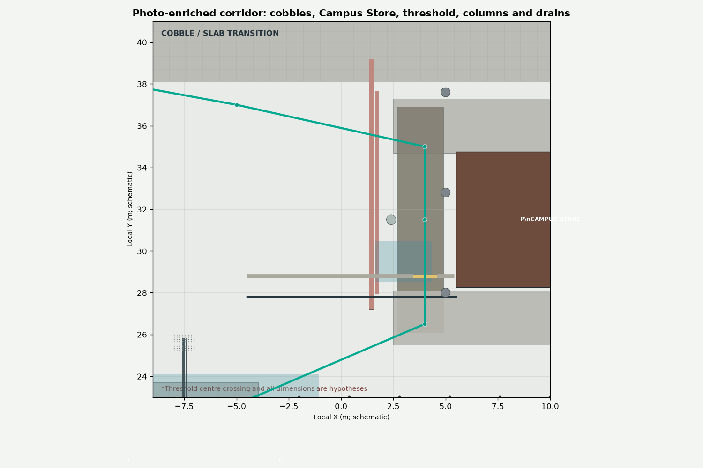
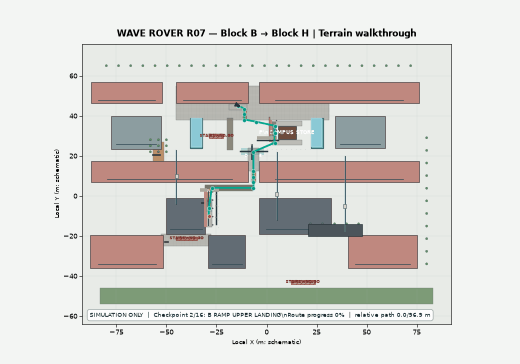

# R07 simulation workspace — TH Deggendorf Block B → Block H

This is an isolated simulation branch; it does not change the firmware on `main`.

## University terrain and route
The outdoor terrain is based on the official TH Deggendorf campus block diagram and building index:
- [Official THD campus map](https://www.th-deg.de/Hochschule/anfahrt)
- [Map Deggendorf and building index (PDF)](https://www.th-deg.de/Fakult%C3%A4ten/agw/Guide-LSI.pdf)

The public drawing labels the buildings and their relative positions, but it is not a metric survey with exact coordinates, footprints, entrance positions or pedestrian path centerlines. The terrain `terrain/dit_deggendorf_b_to_h.json` therefore has status `SCHEMATIC_APPROXIMATION_NOT_SURVEYED`. It is useful for path-planner tests, not for claiming precise campus navigation. The Block B → H approach is only a candidate until checked against actual walkways and entrances on site.

## Known robot geometry and simulated hardware
- Known rover planform from supplied project context: 0.30 m long × 0.20 m total width.
- Box enclosure size, wheel track/radius, caster layout and several sensor mounting angles are editable estimates; measure these to improve geometric fidelity.
- Five ultrasonic sensors are represented in firmware order: front, left, right, back, front angled.
- LiDAR is modeled as 90 bins at 4° spacing and up to 3.5 m.
- BNO055 yaw is simulated. The physical rover has no wheel encoders; any Gazebo odometry topic is simulator-only.

## Start now: standalone 2D simulator
```bash
cd simulation/tools
python3 -m venv .venv
source .venv/bin/activate
pip install -r requirements.txt
python3 r07_campus_sim.py
```
Controls: **A** run route B→H, **P** pause, **Space** stop, **R** reset, **WASD/arrows** manual drive, **+/- or mouse wheel** zoom, **Esc** quit. The route planner inflates buildings by the rover's circumscribed radius plus a margin. On reaching the H approach point, the simulator latches `FINISHED` and holds both commands at zero.

Run a headless planner check:
```bash
python3 r07_campus_sim.py --self-test
```

## ROS 2 / Gazebo Classic 3D model
`ros2_ws/src/r07_description` contains a URDF/Xacro model with chassis, separate CAS Box enclosure, differential-drive wheels, LiDAR, five ultrasound rays and IMU sensor. `ros2_ws/src/r07_simulation` contains an outdoor campus world with schematic building prisms. Building heights are placeholders.

```bash
cd simulation/ros2_ws
rosdep install --from-paths src --ignore-src -r -y
colcon build --symlink-install
source install/setup.bash
ros2 launch r07_simulation r07_world.launch.py
```
This optional launch targets ROS 2 + Gazebo Classic `gazebo_ros_pkgs`. ROS/Gazebo compatibility depends on your Ubuntu/ROS distribution. If unavailable, use the standalone 2D simulator first.

## LiDAR signature plotting
```bash
python3 simulation/tools/scan_to_polar_map.py --label END_SCAN_entrance
```
This creates a polar plot and CSV from the final inside-washroom signature as confirmed by the operator. A single-pose scan is not a map and does not estimate x/y. The indoor washroom signature and outdoor Block B→H campus terrain are separate simulation assets.

## Before using the route on real hardware
Measure the real walkable path, entrance coordinates, building offsets and route width; verify ramps/steps/roads/access restrictions. Confirm R07 sensor orientation, mounting heights, wheel track/radius, and box enclosure dimensions. Simulation success alone does not validate hardware safety or navigation performance.


## Photo-derived campus terrain details

The photo-enrichment inventory is in [`terrain/photo_detail_overlay.json`](terrain/photo_detail_overlay.json). It records the features visible in the user-provided stills/video: small cobbles, a transverse raised curb/threshold, slab-paving transitions, a covered colonnade with columns, tactile guide rails and dot pads, circular flush ground covers, linear drainage grates, wet-surface zones, Campus Store pavilion cues, D/E signs and optional pedestrian stop/yield scenarios.

**Important coordinate note:** the feature inventory is descriptive and does not provide a surveyed campus coordinate transform. The fully photo-enriched package generated in this conversation contains the detailed mesh and Gazebo SDF with representative model-local positions. The simpler branch terrain JSON uses a different, smaller coordinate frame; do not copy the photo detail coordinates into it without transforming/re-aligning them first.

The curb's lower centre crossing is a simulation hypothesis. The images show a raised transverse edge, but not the exact height or proof of a lowered crossing. Dimensions, route alignment, wet-friction settings and ramp grades remain estimates and must be surveyed before considering real-world use.


## Screenshots and video walkthrough

The screenshot set and short route animation are generated from the detailed terrain JSON whenever the rendering script or terrain source is updated.

**3D campus overview**



**Top-down campus layout and B → H candidate route**



**Photo-enriched corridor**



**Animated route preview**



[Watch/download the MP4 walkthrough](media/route_walkthrough.mp4)

To regenerate these files locally:

```bash
python3 -m pip install matplotlib
sudo apt-get install ffmpeg
python3 simulation/tools/generate_readme_media.py
```

The generated media includes route/terrain visualization, not a recording of live Gazebo physics or the physical robot. The coordinates, object dimensions, ramp grades, and finish location remain schematic estimates.
